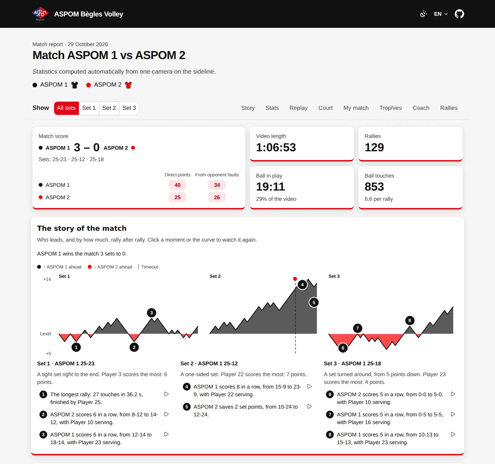
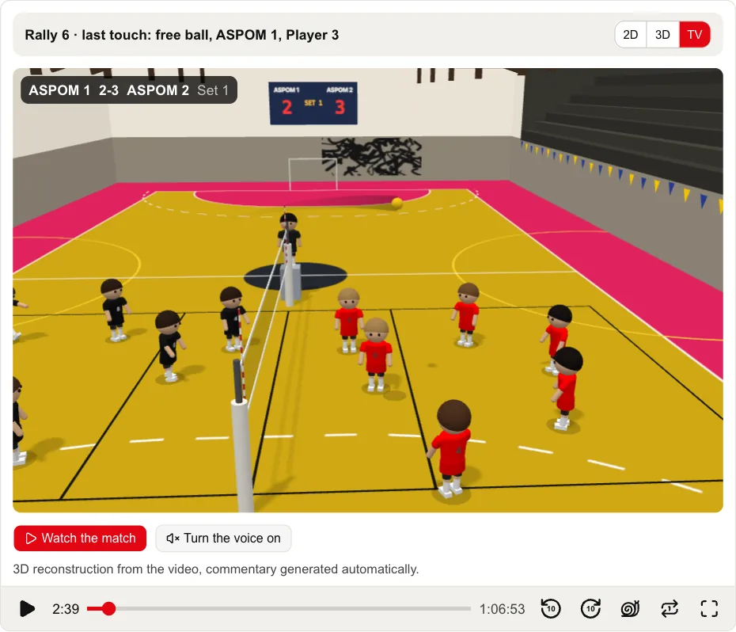
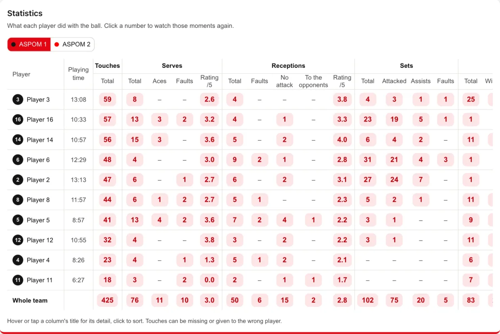
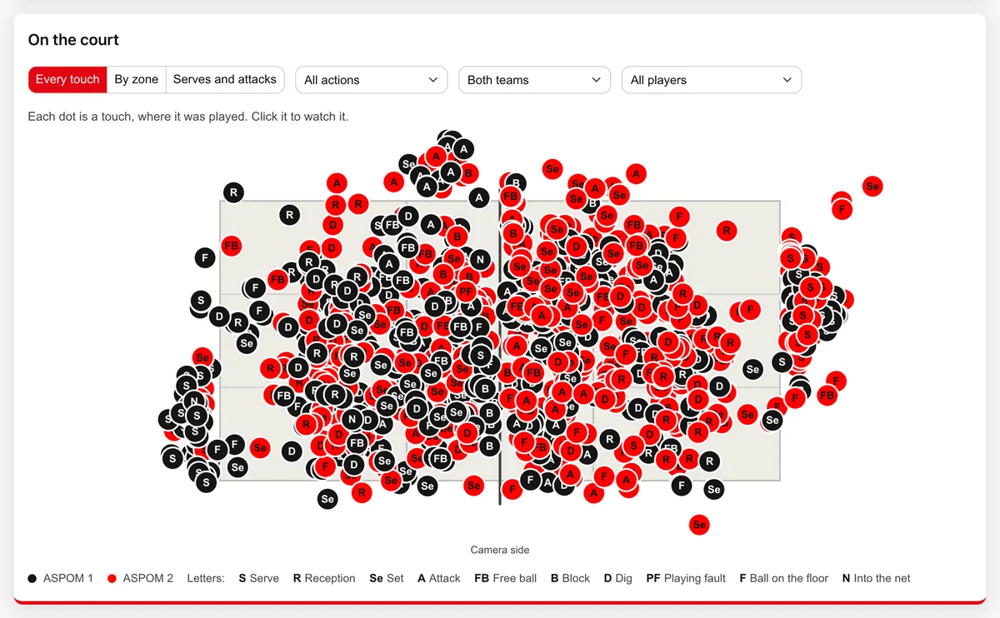
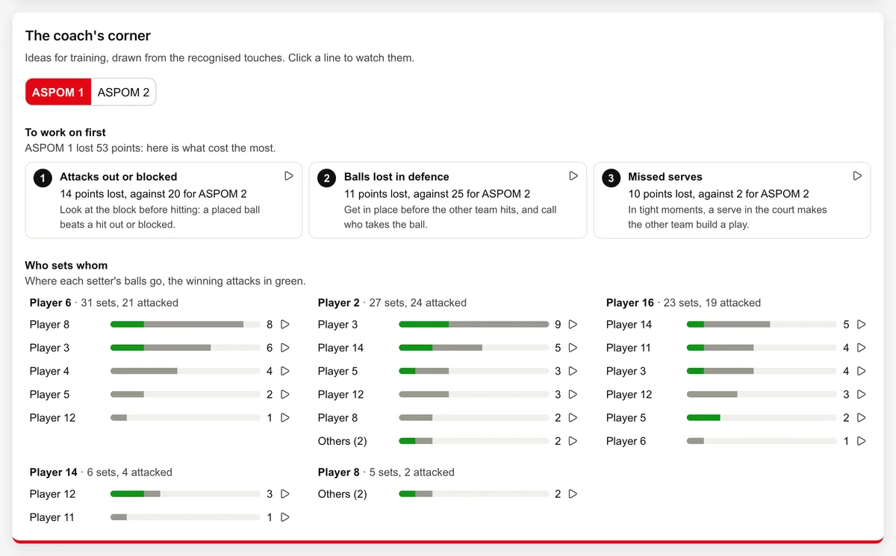
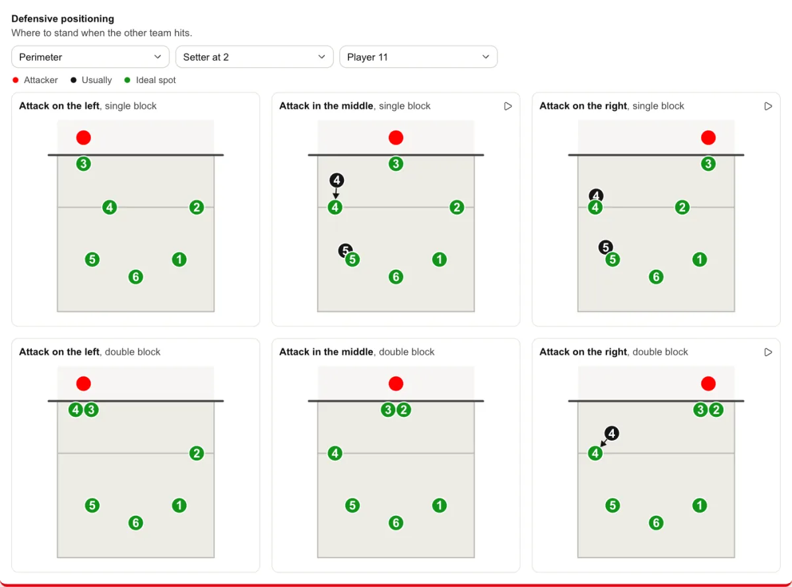
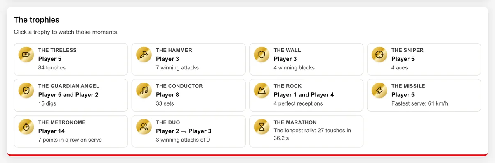
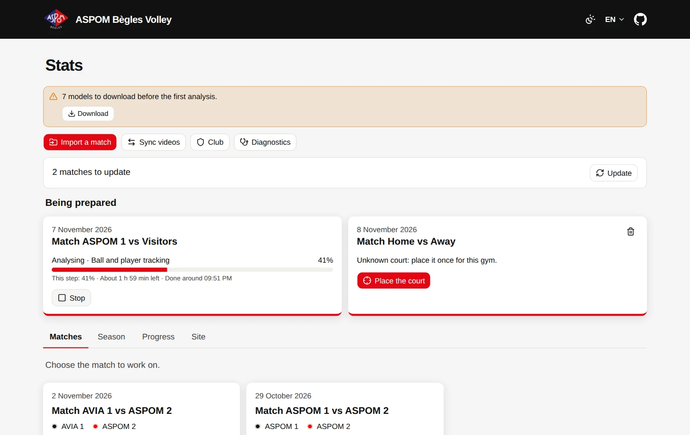
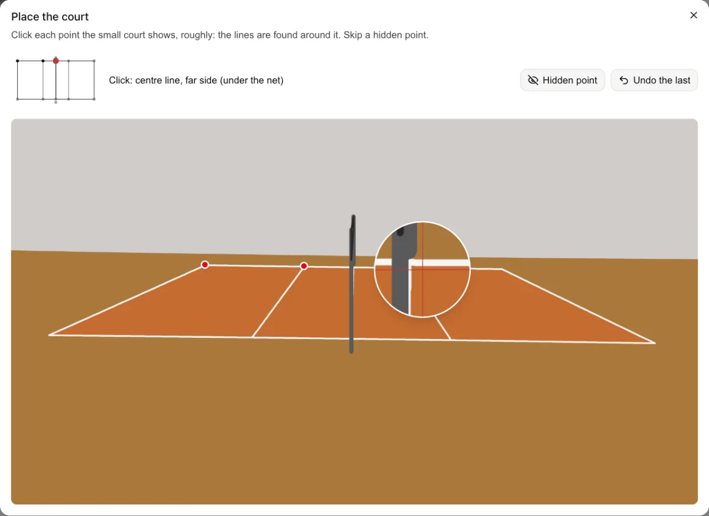
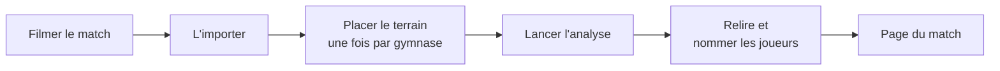

<div align="center">

[English](README.md) · **Français**

# volleyball-stats

**Les statistiques de chaque joueur de volley, avec une seule caméra au bord du terrain.**

Filmez un match, l'analyse trouve chaque touche, vous nommez les joueurs une fois :<br>
vous obtenez une page du match où chaque chiffre rejoue ses moments.

[](LICENSE)
[](pyproject.toml)
[](docs/setup.md)

<br>



</div>

## Ce que vous obtenez

À partir de la vidéo d'un match entier, sans rien noter à la main :

- **Les statistiques de chaque joueur :** services, réceptions, passes, attaques, contres et défenses, avec leurs
  résultats, notes et fautes, équipe par équipe et set par set.
- **Chaque moment à revoir :** cliquez sur un chiffre, un point ou un trophée pour revoir ces touches, dans la vidéo
  ou sur un terrain animé en 2D, en 3D ou en mode TV commenté.
- **L'histoire du match :** l'écart au score échange après échange, les séries, les remontées et les balles de set
  sauvées.
- **Des conseils pour l'équipe :** ce qui a coûté le plus de points (sans nommer personne pour une faute), qui passe à
  qui, le saut d'attaque, le placement en réception et en défense, et des trophées pour ce que les joueurs ont bien fait.
- **Mon match :** chaque joueur choisit son nom et voit ses propres touches, ses meilleurs points et sa carte.
- **Une page à partager :** des fichiers statiques qui s'ouvrent depuis le disque ou s'hébergent n'importe où, en
  français et en anglais, en clair ou en sombre. Sans vidéo par défaut : aucun joueur n'apparaît filmé sans son accord.
- **Aux couleurs du club :** son nom, son logo, ses couleurs et ses partenaires sur chaque page.
- **Aucune commande à apprendre :** une ligne l'installe ; importer un match, placer le terrain, suivre l'analyse et
  mettre à jour, tout se fait dans le navigateur.

La seule étape à la main est de nommer les joueurs : l'analyse regroupe chaque touche par joueur, une page de relecture
pose des questions sur ceux dont elle doute, et vous nommez chaque joueur une fois. Les noms des joueurs déjà vus lors
de matchs précédents sont proposés.

## Captures d'écran

<table>
  <tr>
    <td width="50%"><br><b>Mode TV :</b> chaque échange reconstitué en 3D, filmé comme à la télévision</td>
    <td width="50%"><br><b>Statistiques :</b> les touches de chaque joueur et leurs résultats</td>
  </tr>
  <tr>
    <td width="50%"><br><b>Sur le terrain :</b> chaque touche là où elle a été jouée</td>
    <td width="50%"><br><b>Le coin du coach :</b> ce qu'il faut travailler, qui passe à qui</td>
  </tr>
  <tr>
    <td width="50%"><br><b>Placement :</b> où un joueur se place d'habitude, face à la place idéale</td>
    <td width="50%"><br><b>Trophées :</b> ce que les joueurs ont bien fait</td>
  </tr>
  <tr>
    <td width="50%"><br><b>L'application :</b> importer un match, suivre son analyse, garder chaque match à jour</td>
    <td width="50%"><br><b>Un nouveau gymnase :</b> cliquer une fois sur les points du terrain</td>
  </tr>
</table>

Captures d'un vrai match, noms des joueurs masqués ; les matchs en préparation sont mis en scène et le terrain à placer
est un dessin.

## Comment ça marche



L'analyse lit la vidéo une fois : elle trouve les échanges, suit le ballon et ses touches, donne son type à chaque
touche (service, réception, passe, attaque, contre, défense), suit les joueurs, les répartit en équipes, suit chacun
tout le match et tient le score. Chaque étape est mesurée sur des annotations faites à la main, dans
[`benchmarks/`](benchmarks). Voir [le pipeline](docs/pipeline.md) (en anglais) pour les méthodes et leur précision.

## Pour commencer

### 1. Installer

Il faut un ordinateur avec une carte graphique : une NVIDIA, ou un Mac à puce Apple (plus lent). Sur Windows ou Mac,
[téléchargez-la](https://github.com/josselinbuils/volleyball-stats/releases/latest) et double-cliquez sur le fichier :
la page montre comment passer l'avertissement du système sur un fichier non signé.

Ou, dans un terminal (sur Mac : l'application Terminal), collez cette ligne puis appuyez sur Entrée :

```bash
curl -LsSf https://raw.githubusercontent.com/josselinbuils/volleyball-stats/main/install.sh | sh
```

Elle installe ce qui manque et ouvre l'application dans sa propre fenêtre. Les fois suivantes, ouvrez « Volleyball
Stats » : dans Applications sur Mac (fermer sa fenêtre la masque, Quitter la ferme), sur le bureau ou dans le menu
Démarrer sur Windows (fermer sa fenêtre la ferme), dans le menu des applications sur Linux.

Sur Windows, collez plutôt ceci dans PowerShell :

```powershell
irm https://raw.githubusercontent.com/josselinbuils/volleyball-stats/main/install.ps1 | iex
```

Ou lancez-la dans Ubuntu (WSL2) : dans PowerShell en administrateur, lancez `wsl --install -d Ubuntu-24.04`,
redémarrez, ouvrez « Ubuntu » depuis le menu Démarrer, choisissez un nom d'utilisateur et un mot de passe, puis collez-y
la première ligne. Voir [Installation](docs/setup.md) (en anglais) pour le pilote NVIDIA.

Le bouton « Diagnostic » de l'application vérifie la carte graphique, la mémoire, l'espace disque et les outils, et dit
quoi corriger ; il montre aussi le journal de l'application.

### 2. Filmer un match

Une caméra fixe sur un côté du terrain, face au filet, le plus haut possible (3 m ou plus) et assez loin pour voir les
deux lignes de fond. Filmez en 4K (2,7K au moins) à 50 images par seconde, exposition bloquée. « Filmer un match » dans
l'application montre le placement et les réglages, « Tester le cadrage » le vérifie. Voir
[Enregistrement](docs/recording.md) (en anglais) pour une installation complète et la calibration de l'objectif.

### 3. Tout le reste, dans l'application

1. **Importer un match :** choisissez la carte de la caméra, nommez l'équipe de gauche au premier échange, puis
   l'autre.
2. **Vérifier :** l'application trouve le terrain dans un gymnase qu'elle connaît ; la première fois dans un gymnase,
   cliquez une fois sur ses coins et ses lignes. Vérifiez les côtés et les lignes du terrain sur deux images, puis
   lancez l'analyse : quelques heures pour un match de 2 h.
3. **Relire :** une fois analysé, le match s'ouvre dans la relecture. Nommez chaque joueur d'après ses photos,
   répondez aux questions sur les joueurs dont elle doute, puis appliquez : la page du match est refaite en quelques
   secondes.
4. **Mettre à jour :** vos réponses apprennent à l'analyse. Quand des matchs l'attendent (de nouvelles réponses, ou une
   nouvelle version du code), « Mettre à jour » dans la liste les relance tous d'un coup ; l'onglet « Progrès » montre
   ce que les réponses ont appris.

« Club » règle le nom du club, son logo, ses couleurs, ses équipes et ses partenaires, les mêmes sur chaque page. La
page du match est dans `outputs/matches/MATCH/site/index.html`. L'onglet « Site » de l'application zippe les pages
pour n'importe quel hébergeur (« Exporter le site »), ou les envoie sur votre propre serveur
([en installer un](docs/hosting.md#your-own-server), en anglais), puis « Mettre en ligne » dans la relecture. Quand une
nouvelle version sort, l'application se met à jour toute seule quand elle ne fait rien.

Les développeurs la lancent avec `uv run stats` (`uv run stats --help` pour les autres commandes). Chaque étape a aussi
sa commande, avec toutes ses options : [Traiter un match](docs/processing.md) (en anglais).

## Documentation

La documentation détaillée est en anglais.

| Guide | Ce qu'il couvre |
| --- | --- |
| [Setup](docs/setup.md) | Prérequis, installation sous WSL2 ou macOS, temps de traitement et mémoire |
| [Recording](docs/recording.md) | Placement de la caméra, matériel, réglages, calibration de l'objectif |
| [Processing a match](docs/processing.md) | Import, terrain, analyse, relecture, construction de la page et hébergement, avec chaque option |
| [The match page](docs/match-page.md) | Chaque partie de la page, comment chaque statistique est comptée, modifier la page |
| [Pipeline](docs/pipeline.md) | La méthode et le benchmark de chaque étape, la précision, les travaux existants |
| [Literature](docs/literature.md) | Les travaux scientifiques par étape, avec des recommandations |

## Développement

Clonez le dépôt et lancez `./install.sh` dedans : il garde votre copie (« Mettre à jour » dans l'application la met
alors à jour avec git) et installe le reste.

```bash
git clone https://github.com/josselinbuils/volleyball-stats && cd volleyball-stats && ./install.sh
uv run pytest -q                                  # tests Python
cd web && npm install && npm test && npm run build   # la page (Node 22), sa construction commitée
```

Chaque étape de l'analyse a un benchmark dans [`benchmarks/`](benchmarks) : changez une étape, lancez son benchmark,
comparez les chiffres avant et après.

## Vie privée

Publier des vidéos, des photos de joueurs ou des jeux de données demande l'accord de chaque joueur filmé (des parents
pour les mineurs), adversaires compris. La page ne montre aucune vidéo ni photo de joueur sauf si on le demande.

## Licence

[AGPL-3.0](LICENSE), pour pouvoir réutiliser des dépendances AGPL comme Ultralytics YOLO et VolleyVision. Le code
GPL-2.0 seulement, comme volleyball_analytics, est incompatible : référence uniquement.
