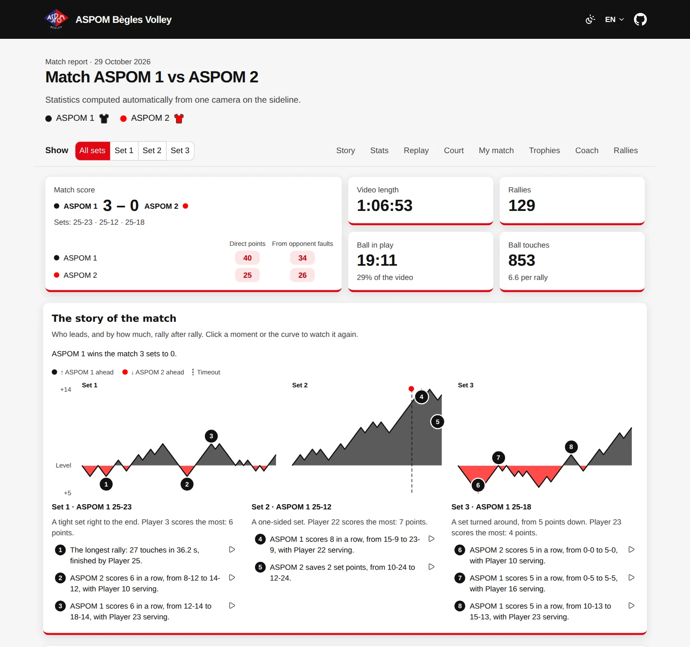
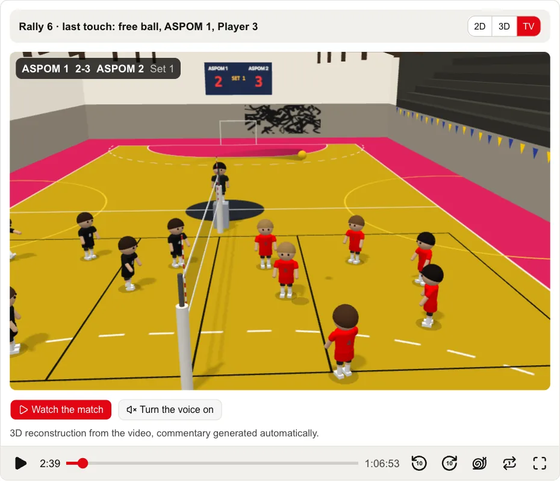
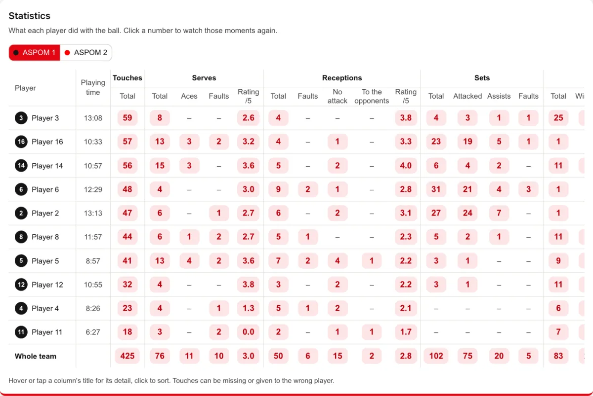
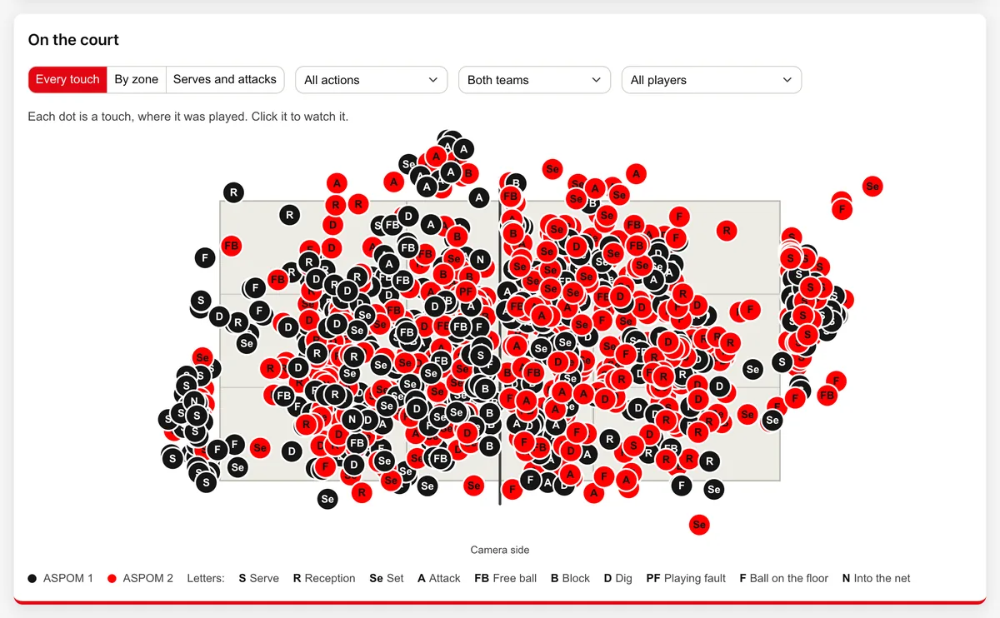
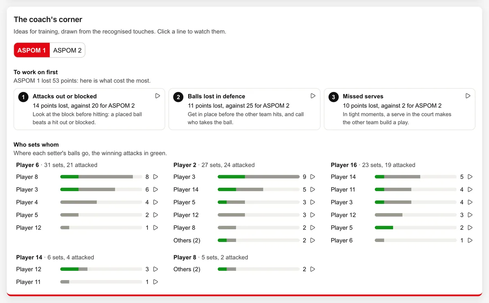
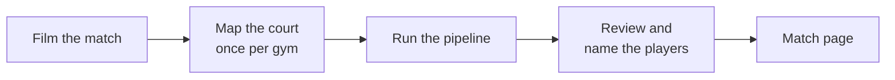

<div align="center">

# volleyball-stats

**Per-player volleyball statistics from one camera on the sideline.**

Film a match, let the pipeline find every touch, name the players once:<br>
you get a match page where every number replays its moments.

[](LICENSE)
[](pyproject.toml)
[](docs/setup.md)

<br>



</div>

## What you get

From the video of a whole match, with no tagging by hand:

- **Every player's statistics:** serves, receptions, sets, attacks, blocks and digs, with their
  outcomes, ratings and faults, team by team and set by set.
- **Every moment replayable:** click a number, a dot or a trophy to watch those touches, in the video
  or on an animated court in 2D, 3D or a TV-style broadcast with commentary.
- **The story of the match:** the score gap rally by rally, runs, comebacks and set points saved.
- **Advice for the team:** what cost the most points and who sets whom, naming no one for a fault, and
  trophies for what players did well.
- **My match:** each player picks their name and sees their own touches, best points and card.
- **A page to share:** static files that open from disk or host anywhere, in French and English, light
  or dark. With no footage by default, so no player shows on video without their consent.

The only manual step is naming the players: the pipeline groups every touch into identities, a review
page asks about the ones it is unsure of, and you name each player once. A roster suggests the names
of players already seen in earlier matches.

## Screenshots

<table>
  <tr>
    <td width="50%"><br><b>TV mode:</b> each rally rebuilt in 3D, filmed like a broadcast</td>
    <td width="50%"><br><b>Statistics:</b> each player's touches and their outcomes</td>
  </tr>
  <tr>
    <td width="50%"><br><b>On the court:</b> every touch where it was played</td>
    <td width="50%"><br><b>The coach's corner:</b> what to work on, who sets whom</td>
  </tr>
</table>

Screenshots of a real match, with the players' names hidden.

## How it works



The pipeline reads the video once and finds the rallies, tracks the ball and its contacts, types each
touch (serve, reception, set, attack, block, dig), tracks the players, splits them into teams, follows
each one through the whole match and keeps the score. Each step is scored against hand labels in
[`benchmarks/`](benchmarks). See [the pipeline](docs/pipeline.md) for the methods and their accuracy.

## Getting started

### 1. Install

You need a GPU (NVIDIA, or Apple Silicon at a slower pace), [`uv`](https://docs.astral.sh/uv/) and
`ffmpeg`.

```bash
git clone https://github.com/josselinbuils/volleyball-stats.git
cd volleyball-stats
uv sync
```

On Windows, run it in WSL2: see [Setup](docs/setup.md).

### 2. Film a match

One fixed camera on a sideline, in line with the net, about 6 m away and 3.6 m high, framing both end
lines. Film in 4K (2.7K minimum) at 50 fps with the exposure locked. See [Recording](docs/recording.md)
for the stand, the camera settings and the lens calibration.

### 3. Import it

```bash
uv run python -m volleyball_stats.import_match /Volumes/SD_CARD --teams "Home:navy,Away:white"
```

It joins the camera's files into `data/MATCH/MATCH.mp4` and starts `outputs/MATCH/`, where `MATCH` is
the match's date and teams, e.g. `2026-11-08-home-vs-away`. The first team is the one on the left at the
first rally.

### 4. Map the court

Once per gym: click roughly on the court lines, and the fit snaps them to the painted lines.

```bash
uv run python -m volleyball_stats.court click data/MATCH/MATCH.mp4
uv run python -m volleyball_stats.court fit outputs/court/MATCH_clicks.json data/MATCH/MATCH.mp4 \
  --court my_gym
```

The next matches in that gym use `court auto` instead.

### 5. Run the pipeline

```bash
uv run python -m volleyball_stats.match data/MATCH/MATCH.mp4 \
  --court outputs/courts/my_gym.json --players
```

This is the long step: hours for a 2-hour match.

### 6. Review and name the players

```bash
uv run python -m volleyball_stats.review outputs/MATCH
```

It opens a page in your browser, on this machine only. Name each player from their pictures, answer the
questions it asks about the players it is unsure of, then apply: the match page is rebuilt in seconds.

### 7. Open the match page

```bash
uv run python -m volleyball_stats.web outputs/MATCH --video data/MATCH/MATCH.mp4 \
  --court outputs/courts/my_gym.json --theme none
```

Open `outputs/MATCH/site/index.html`. `--theme` takes your club's colours and logo (see
[`branding/brand.example.json`](branding/brand.example.json)), `--footage` adds the video, and the same
files can be hosted as they are.

Every option of every step: [Processing a match](docs/processing.md).

## Documentation

| Guide | What it covers |
| --- | --- |
| [Setup](docs/setup.md) | Requirements, install on WSL2 or macOS, processing time and memory |
| [Recording](docs/recording.md) | Camera placement, hardware, settings, lens calibration |
| [Processing a match](docs/processing.md) | Import, court, pipeline, review, page build and hosting, with every option |
| [The match page](docs/match-page.md) | Each section of the page, how each statistic is counted, changing the page |
| [Pipeline](docs/pipeline.md) | Each step's method and benchmark, accuracy, prior art |
| [Literature](docs/literature.md) | Scientific work per pipeline step, with recommendations |

## Development

```bash
uv run pytest -q                                  # Python tests
cd web && npm install && npm test && npm run build   # the page (Node 22), its build committed
```

Each pipeline step has a benchmark in [`benchmarks/`](benchmarks): change a step, run its benchmark,
compare the numbers before and after.

## Privacy

Published footage, player pictures or datasets require the consent of every filmed player (parents for
minors), opponents included. The page shows no video and no player picture unless asked to.

## License

[AGPL-3.0](LICENSE), so AGPL dependencies such as Ultralytics YOLO and VolleyVision can be reused.
GPL-2.0-only code, such as volleyball_analytics, is incompatible: reference only.
