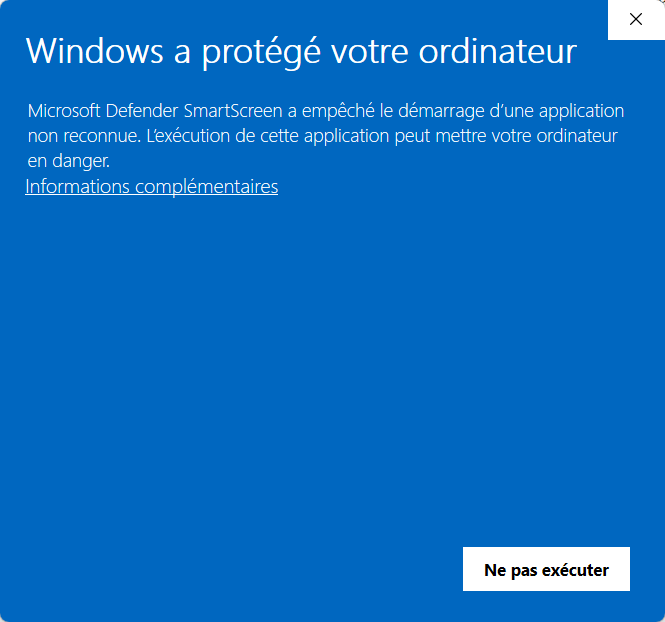
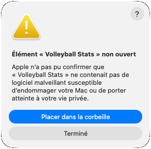
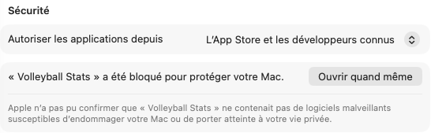

## [Windows](https://github.com/josselinbuils/volleyball-stats/releases/latest/download/volleyball-stats-setup.exe) · [Mac](https://github.com/josselinbuils/volleyball-stats/releases/latest/download/volleyball-stats.dmg)

Téléchargez, puis double-cliquez : Volleyball Stats s'installe et s'ouvre. La première fois prend de longues minutes.\
_Download, then double-click: Volleyball Stats installs and opens. The first time takes many minutes._

### Windows

Windows bloque les fichiers non signés : **Informations complémentaires**, puis **Exécuter quand même**.\
_Windows blocks unsigned files: **More info**, then **Run anyway**._

 

### Mac

Glissez Volleyball Stats dans Applications et ouvrez-la. macOS la bloque une fois : **Terminé**, puis dans **Réglages Système › Confidentialité et sécurité**, en bas, **Ouvrir quand même**, et confirmez.\
_Drag Volleyball Stats to Applications and open it. macOS blocks it once: **Done**, then in **System Settings › Privacy & Security**, at the bottom, **Open Anyway**, and confirm._

 

### Sans fichier · _Without a file_

Windows, dans PowerShell :

```powershell
irm https://raw.githubusercontent.com/josselinbuils/volleyball-stats/main/install.ps1 | iex
```

Mac, dans le Terminal :

```sh
curl -LsSf https://raw.githubusercontent.com/josselinbuils/volleyball-stats/main/install.sh | sh
```

Ses mises à jour se font ensuite dans l'application.\
_Its updates are then made in the app._
