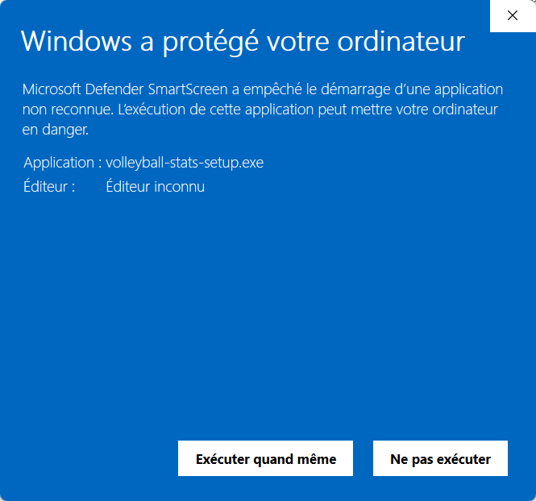

## [Windows](https://github.com/josselinbuils/volleyball-stats/releases/latest/download/volleyball-stats-setup.exe) · [Mac](https://github.com/josselinbuils/volleyball-stats/releases/latest/download/volleyball-stats.dmg)

[Français](#français) · [English](#english)

## Français

Téléchargez, puis double-cliquez : Volleyball Stats s'installe et s'ouvre. La première fois prend de longues minutes.
Ensuite, l'application se met à jour toute seule.

### Windows

Windows bloque les fichiers non signés : **Informations complémentaires**, puis **Exécuter quand même**.

 

### Mac

Glissez Volleyball Stats dans Applications et ouvrez-la. macOS la bloque une fois : **Terminé**, puis dans
**Réglages Système › Confidentialité et sécurité**, en bas, **Ouvrir quand même**, et confirmez.

 

### Sans fichier

Windows, dans PowerShell :

```powershell
irm https://raw.githubusercontent.com/josselinbuils/volleyball-stats/main/install.ps1 | iex
```

Mac, dans le Terminal :

```sh
curl -LsSf https://raw.githubusercontent.com/josselinbuils/volleyball-stats/main/install.sh | sh
```

## English

Download, then double-click: Volleyball Stats installs and opens. The first time takes many minutes. After that, the
app updates itself.

### Windows

Windows blocks unsigned files: **More info**, then **Run anyway**.

 

### Mac

Drag Volleyball Stats to Applications and open it. macOS blocks it once: **Done**, then in
**System Settings › Privacy & Security**, at the bottom, **Open Anyway**, and confirm.

 

### Without a file

Windows, in PowerShell:

```powershell
irm https://raw.githubusercontent.com/josselinbuils/volleyball-stats/main/install.ps1 | iex
```

Mac, in the Terminal:

```sh
curl -LsSf https://raw.githubusercontent.com/josselinbuils/volleyball-stats/main/install.sh | sh
```
